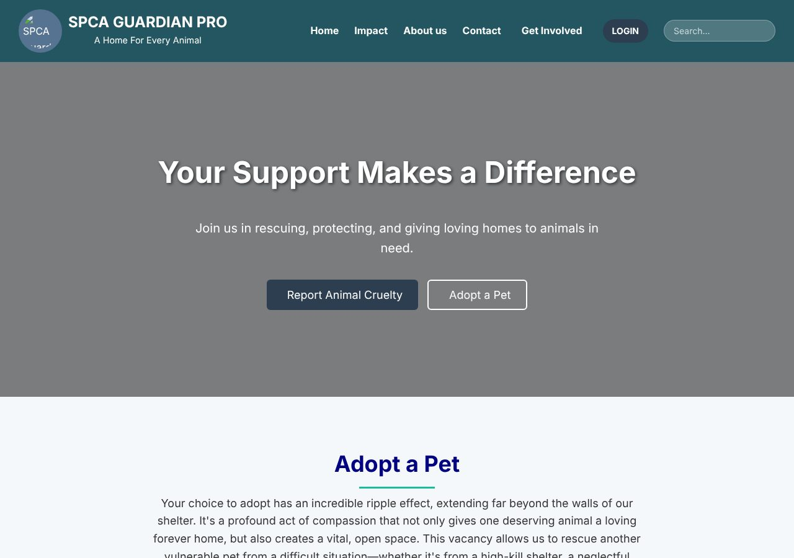
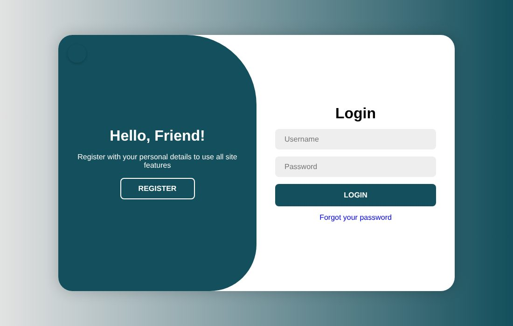
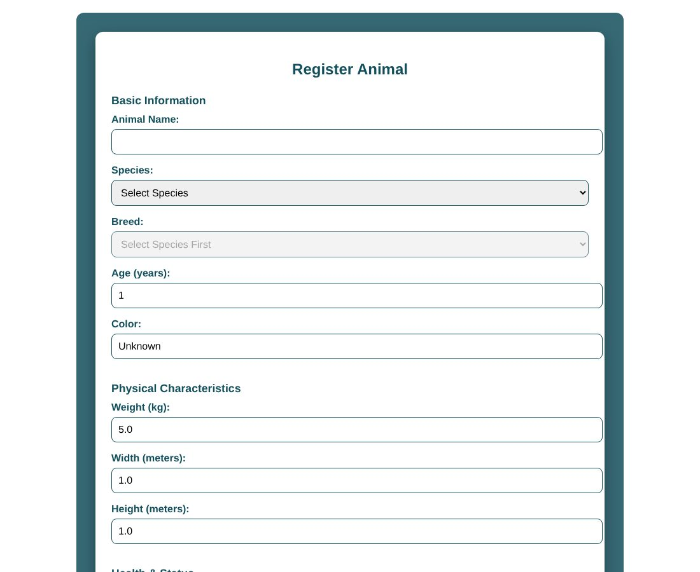
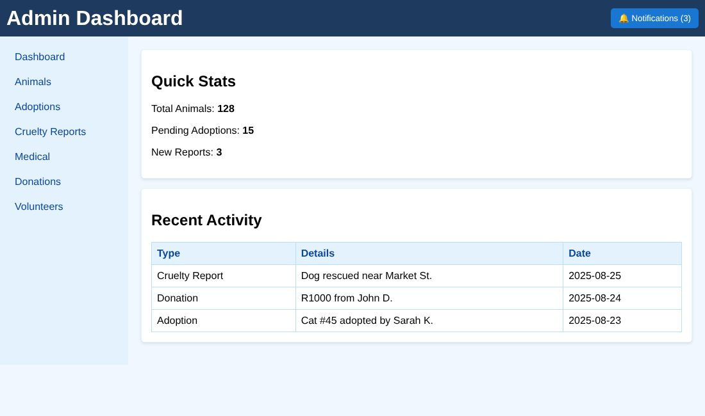
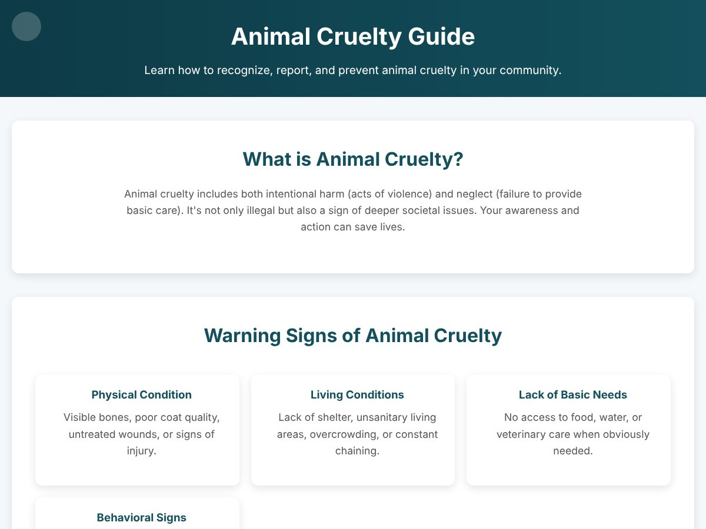

# SPCA Guardian Pro

[](https://github.com/NsukuGwebana/spca-guardian-pro/actions/workflows/ci.yml)


A web-based shelter management system for an SPCA animal welfare organisation. It brings animal intake, kennel management, adoptions, fostering, veterinary care, cruelty reporting, volunteers and donations into one system, with role-based dashboards for staff and public pages for the community.

Built as a year-long final-year Information Systems team project at Rhodes University (2025), following the full Software Development Life Cycle: requirements analysis, design, development, testing and delivery.



## My contributions (Nsuku Gwebana)

I designed and built the two main entry points to the system, and contributed to documentation, testing and the final presentation.

**Admin dashboard** ([`adminDashboard.php`](adminDashboard.php))
- Session-protected staff dashboard: users who aren't logged in are sent to the login page, and the signed-in user's name and role are shown
- Summary cards from live database counts: new cruelty reports, pending adoptions, animals available for adoption and donations in the last 30 days
- Recent activity feed that merges the latest adoptions, cruelty reports and donations into one timeline with a SQL `UNION`
- Navigation hub linking about 30 staff modules: animals and kennels, adoptions and fostering, cruelty reports, volunteers and events, donations, users, subscribers, and the reporting and analytics pages

**Public homepage** ([`Homepage.html`](Homepage.html))
- Hero banner with calls to action for reporting cruelty and adopting
- Navigation with a Get Involved menu for adopting, fostering, volunteering, donating and tracking applications
- Live impact statistics loaded with `fetch()` from a PHP endpoint, with animated counters, auto-refresh every five minutes and a fallback if the request fails
- Site search that filters the page's sections, highlights matches and jumps to the result
- Community, highlights, success stories, newsletter sign-up and a map of the shelter
- Responsive layout for phones and tablets

**Improving it after submission (November 2026)**
- Went back to the code, tested every page as each user role, and fixed the bugs found (see [CHANGES.md](CHANGES.md))
- Hardened security: prepared statements throughout, CSRF protection, output escaping, login lockout and password reset by email
- Added an adoption pipeline (Pending → Home visit → Approved → Adopted) that emails applicants at each step, a management dashboard with KPIs, a volunteer dashboard, an activity log, and CSV export on every list
- Added PHPUnit tests, GitHub Actions CI and a Docker setup, and put the system live on InfinityFree

## What it does

| Area | Features |
|---|---|
| **Animals & kennels** | Animal intake and registration with photos, animal profiles, PDF profile export, kennel registration, automatic and manual kennel allocation by size and species |
| **Adoptions & fostering** | Public adoption and foster applications with SA ID validation, an adoption pipeline (Pending → Home visit → Approved → Adopted) that emails the applicant at every step, ID check at handover, post-adoption follow-ups, public progress tracking |
| **Veterinary care** | Vet dashboard, medical appointments, treatments and procedures, medical care reports |
| **Animal cruelty** | Public cruelty reporting, investigation tracking, cruelty trend charts |
| **Donations** | Donation capture, donation trends, emailed PDF receipts |
| **Volunteers & community** | Volunteer sign-up, events, community engagement tracking, participation charts |
| **Management** | KPI dashboard (days to adoption, kennel occupancy, approval rate, donations by month, cruelty reports by area), CSV export on every list, search, filters and pagination |
| **Admin** | Role-based dashboards (Administrator, Vet, Volunteer), user management, activity log, password reset by email, newsletter subscribers, contact messages |

| Login and registration | Animal intake |
| --- | --- |
|  |  |

| Admin dashboard | Public cruelty guide |
| --- | --- |
|  |  |

## Tech stack

| Layer | Technology |
| --- | --- |
| Front end | HTML5, CSS3 (Flexbox, Grid, media queries), JavaScript (DOM, `fetch` API, JSON) |
| Back end | PHP 8 (mysqli with prepared statements, sessions) |
| Database | MySQL 8 / MariaDB |
| Charts | Chart.js and Google Charts |
| PDF generation | [TCPDF](https://tcpdf.org/) (bundled in `tcpdf/`) |
| Email | [PHPMailer](https://github.com/PHPMailer/PHPMailer) through Brevo SMTP (bundled in `PHPMailer/`) |
| Quality | PHPUnit, GitHub Actions, Docker |

## How it's built

```
Browser ──► page.php ──► bootstrap.php ──► config.php      settings (not in Git)
                │              ├─ error handling            friendly error pages, details to logs/error.log
                │              ├─ secure session + CSRF     every staff form and action link carries a token
                │              ├─ db() / q()                one connection, prepared statements only
                │              └─ log_activity(), send_mail()
                ├──► Session_handler.php                     login check, 15-minute timeout, role permissions
                └──► lib/  workflow.php · validation.php · listing.php   (pure functions, unit tested)
```

### Security

| Threat | Protection |
|---|---|
| SQL injection | Every query with user input uses prepared statements through `q()` |
| Cross-site scripting | All output is escaped with `e()` |
| Cross-site request forgery | Same-origin check on every POST, plus a per-session token on staff forms, AJAX calls and `?action=` links |
| Password guessing | 5 wrong passwords per username (or 20 per IP) lock sign-in for 15 minutes; every attempt is recorded |
| Forgotten passwords | One-time reset link by email, valid for 1 hour; only a SHA-256 hash of the token is stored |
| Session theft | HttpOnly, SameSite cookies; session ID renewed at sign-in; 15-minute idle timeout |
| Access control | Each page lists the roles allowed to open it; everyone else gets a 403 page |
| Leaked errors | SQL and PHP errors are logged privately, visitors see a plain-language message |
| Accountability | Sign-ins, adoption decisions, deletions, exports and edits are written to the activity log |

## Database

The main tables and how they connect (full structure in `database/schema.sql`):

```mermaid
erDiagram
    users ||--o{ activity_log : "does"
    users ||--o{ password_resets : "requests"
    users ||--o{ login_attempts : "signs in"
    animals ||--o{ animal_kennel : "is placed in"
    kennels ||--o{ animal_kennel : "holds"
    animals ||--o{ adoptions : "applied for"
    adoptions ||--o{ appointment : "follow-up visits"
    animals ||--o{ fosters : "fostered by"
    animals ||--o{ appointments : "vet visits"
    appointments ||--o{ treatments : "records"
    donor ||--o{ donations : "gives"
    cruelty_report ||--o| cruelty_investigation : "investigated by"
    events ||--o{ event_signups : "has"

    users {
        int idnumber PK
        string username
        string userpassword "bcrypt hash"
        string userrole "Administrator | Vet | Volunteer"
        string email
    }
    animals {
        int id PK
        string Aname
        string Species
        string Health_status
        string status "Available | Pending | Adopted"
        date Intake_date
    }
    kennels {
        int kennel_id PK
        string kennel_name
        decimal max_width
        decimal max_height
        string status
    }
    animal_kennel {
        int assignment_id PK
        int animal_id FK
        int kennel_id FK
        datetime release_date
    }
    adoptions {
        int id PK
        int animal_id FK
        string full_name
        string id_number
        string status "Pending | Home visit | Approved | Adopted | Rejected"
        datetime home_visit_at
        datetime status_updated_at
    }
    appointment {
        int appointment_id PK
        int adoption_id FK
        datetime appointment_date
        string status
    }
    fosters {
        int id PK
        int animal_id FK
        string id_number
        string status
    }
    appointments {
        int app_id PK
        int animal_id FK
        int vet_id
        date app_date
    }
    treatments {
        int treatment_id PK
        int app_id FK
        string treatment_types
    }
    donor {
        int donor_id PK
        string F_name
        string E_address
    }
    donations {
        int donation_id PK
        int donor_id FK
        float damount
        date ddate
    }
    cruelty_report {
        int id PK
        string location
        string cruelty_type
        date date
    }
    cruelty_investigation {
        int id PK
        int cruelty_id FK
        string status
    }
    events {
        int id PK
        string event_name
        date event_date
    }
    event_signups {
        int id PK
        int event_id FK
        int volunteer_id
    }
    activity_log {
        int id PK
        string username
        string action
        timestamp created_at
    }
    password_resets {
        int id PK
        int user_id FK
        char token_hash "SHA-256"
        datetime expires_at
    }
    login_attempts {
        int id PK
        string username
        string ip_address
        bool success
    }
```



## Running it locally

### With Docker (quickest)

```
docker compose up --build
```

- App: http://localhost:8080 (staff sign in as `admin`, `vet` or `volunteer`, password `Demo12345`)
- Emails the system sends (adoption updates, receipts, password resets): http://localhost:8025

### Without Docker

1. Install PHP 8.2+ with the `mysqli` extension and MySQL 8 (XAMPP or WAMP work well).
2. Create a database and load the structure:
   ```
   mysql -u root -p sysmasters < database/schema.sql
   mysql -u root -p sysmasters < database/migrations/001_security_and_workflows.sql
   ```
3. Copy `config.example.php` to `config.php` and fill in your database and email details. `config.php` is ignored by Git, so passwords never reach GitHub.
4. Start a server in this folder: `php -S localhost:8000`, then open `http://localhost:8000/Homepage.html`. Staff sign in at `Newlogin.html`.

The public sign-up form creates Volunteer accounts. Administrator and Vet accounts are created by a signed-in Administrator.

## Tests

```
composer install
vendor/bin/phpunit
```

- **Unit tests** (`tests/Unit`) cover the adoption workflow rules, SA ID / phone / password validation, pagination and CSV export (including protection against spreadsheet formula injection).
- **Integration tests** (`tests/Integration`) run against a real MySQL database when `DB_HOST` is set: prepared statements, the migration, activity logging and output escaping.
- **GitHub Actions** (`.github/workflows/ci.yml`) runs on every push, on PHP 8.2 and 8.3: syntax-checks every PHP file, builds a fresh database from `schema.sql` and the migrations, runs PHPUnit, then smoke-tests the public pages and checks that staff pages need a login and cross-site forms are blocked.

## Project structure

- `Homepage.html` and the other public pages: adoption, fostering, donations, volunteering, cruelty reports, contact
- `adminDashboard.php`, `vetDashboard.php`, `volunteerDashboard.php` (volunteer): role dashboards
- `bootstrap.php`: loaded by every page; settings, error handling, session, CSRF, database helpers
- `Session_handler.php`: protects every staff page, checks the role and signs users out after 15 minutes idle
- `lib/`: workflow rules, validation, pagination and CSV export (unit tested)
- `partials/topbar.php`: the shared staff page header
- `admin_adoptions.php`: the adoption pipeline; `analytics.php`: management dashboard; `activity_log.php`: who did what
- `config.example.php`: template for database and email settings
- `database/schema.sql`: database structure (no data); `database/migrations/`: changes to apply in order
- `tests/`, `.github/workflows/ci.yml`, `Dockerfile`, `docker-compose.yml`: testing and local setup
- `_unused/`: earlier versions of pages kept for reference; they are not part of the running system

## User guides

The system includes user documentation for each role:
[Admin guide](adminguide.pdf) · [Vet guide](vetguide.pdf) · [Volunteer guide](Volunteerguide.pdf) · [Public guide](publicguide.pdf)

## Team

Built by the SysMasters team, Department of Information Systems, Rhodes University (2025):

- **Nsuku Gwebana** – full stack development (front end, back end, database), testing, documentation and presentation
- **Pozisa Ndzuzo**
- **Ayolisa Smoki**
- **Katlego Moketla**
- **Mbali**

## Note

This was an academic team project, improved and deployed afterwards. Screenshots in this README were captured offline, so photos and icons that load from external sites do not appear in them. See [CHANGES.md](CHANGES.md) for everything fixed and added after the original submission.
