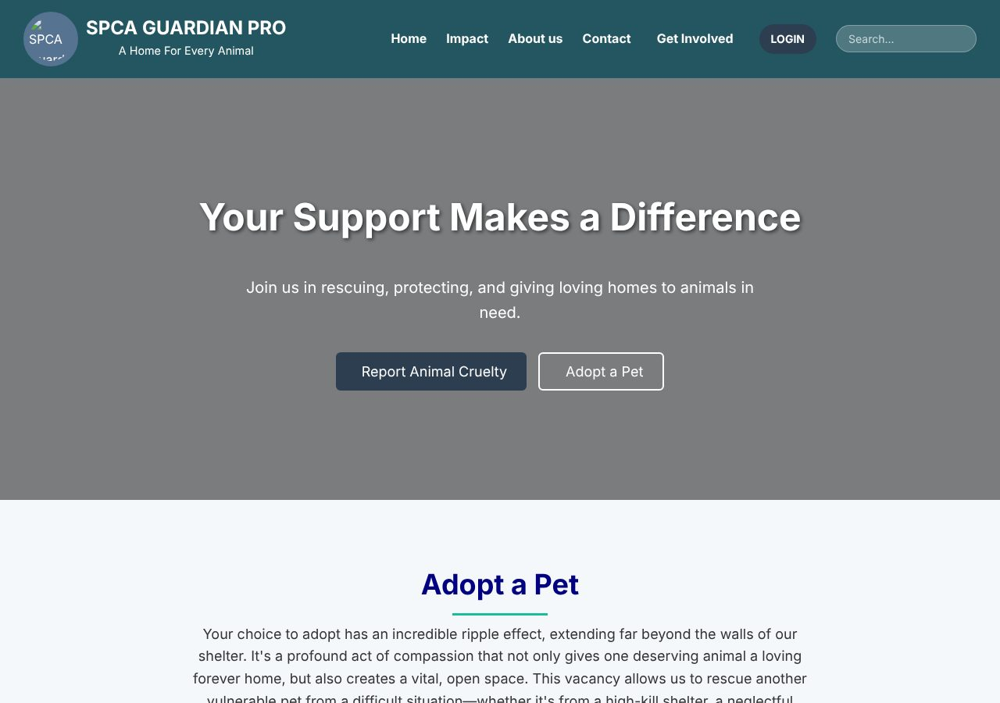
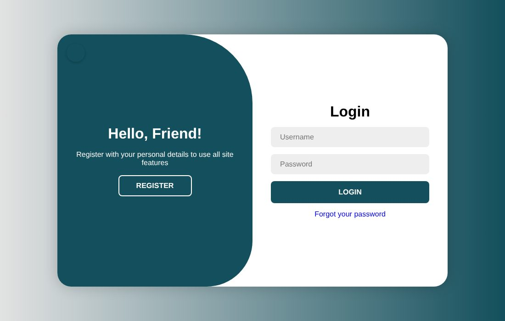
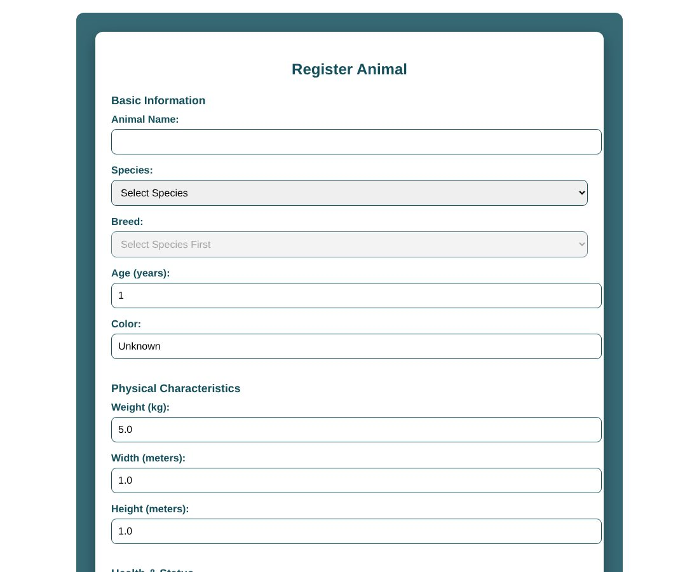
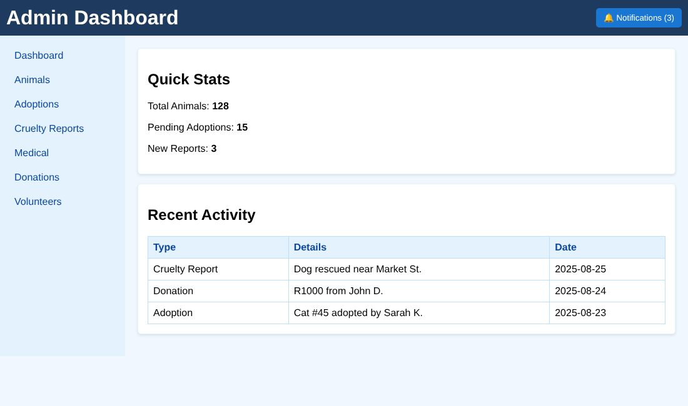
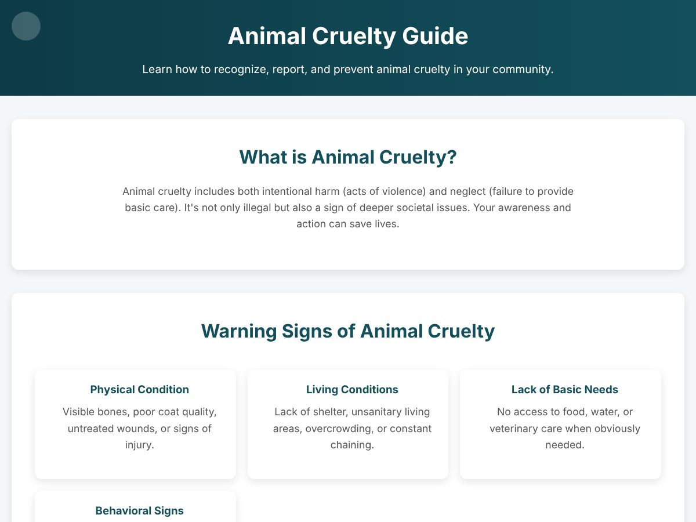

# SPCA Guardian Pro

A web-based shelter management system for an SPCA animal welfare organisation. It brings animal intake, kennel management, adoptions, fostering, veterinary care, cruelty reporting, volunteers and donations into one system, with role-based dashboards for staff and public pages for the community.

Built as a year-long final-year Information Systems team project at Rhodes University (2025), following the full Software Development Life Cycle: requirements analysis, design, development, testing and delivery.

## Features

**Public site**
- Homepage with live impact statistics loaded from the database, site search and a Get Involved menu
- Browse available animals and apply to adopt or foster, then track the application
- Report animal cruelty, with a step-by-step cruelty guide
- Donate through a payment form with client-side card validation (simulated gateway)
- Volunteer registration, events and newsletter sign-up

**Staff system (role-based)**
- Accounts for **Administrator, Manager, Vet, Volunteer and Guest**, each with its own dashboard
- **Animal intake:** species-dependent breed lists, photo upload with preview, and availability set from health status
- **Kennel management:** register, edit, archive and restore kennels; occupancy tracking that marks a kennel *Full* at capacity; kennel matching on the animal's species and size
- **Adoptions and fostering:** screening, approval, history, and an adoption rule that only accepts healthy, available animals
- **Veterinary care:** appointments, follow-ups and medical treatment records
- **Cruelty investigations:** case logging and status tracking
- **Donations:** donation records, acknowledgement emails and PDF receipts
- **Volunteers:** task assignment, activity and hours logging, engagement tracking

**Reporting and analysis**
- Animal intake reports with filters and summary counts by health and adoption status
- Adoption analysis by species, application status and month
- Cruelty report analysis by animal type, cruelty type, location and case status
- Donation trends and medical care reports
- Interactive charts with Google Charts, fed by SQL aggregation (`GROUP BY`, conditional `COUNT`) returned as JSON

| Login and registration | Animal intake |
| --- | --- |
|  |  |

| Admin dashboard | Public cruelty guide |
| --- | --- |
|  |  |

## Tech stack

| Layer | Technology |
| --- | --- |
| Front end | HTML5, CSS3 (Flexbox, Grid, media queries), JavaScript (DOM, `fetch` API, JSON) |
| Back end | PHP (mysqli, sessions) |
| Database | MySQL |
| Charts | Google Charts |
| PDF generation | [TCPDF](https://tcpdf.org/) (bundled in `tcpdf/`) |
| Email | [PHPMailer](https://github.com/PHPMailer/PHPMailer) with Gmail SMTP (bundled in `PHPMailer/`) |

## How it works

Pages such as kennel selection, homepage statistics and the reports dashboards call PHP endpoints (for example `get_available_kennels.php`, `get_report_data.php`, `get_home_stats.php`) with `fetch()`. PHP queries MySQL and returns JSON, which the page renders without reloading. Forms such as registration, login and adoption applications post to their PHP handlers.

User input is handled with prepared statements and bound parameters, numeric IDs are cast to integers, and output is escaped with `htmlspecialchars` to guard against SQL injection and cross-site scripting. Passwords are hashed with `password_hash` and checked with `password_verify`.

## Running it locally

1. Install [XAMPP](https://www.apachefriends.org/) (Apache, PHP and MySQL).
2. Copy this folder into `C:\xampp\htdocs\spca-guardian-pro`.
3. Start **Apache** and **MySQL** in the XAMPP control panel.
4. Open phpMyAdmin at `http://localhost/phpmyadmin`, create a database named `sysmasters` and import the database file from the `database/` folder.
5. Copy `config.example.php` to `config.php` and fill in your database details (on XAMPP: host `localhost`, user `root`, empty password). To send emails, add a Gmail address and a [Gmail App Password](https://support.google.com/accounts/answer/185833).
6. Visit `http://localhost/spca-guardian-pro/Homepage.html`.

`config.php` is listed in `.gitignore`, so real credentials are never committed.

## User guides

The system includes user documentation for each role:
[Admin guide](adminguide.pdf) · [Vet guide](vetguide.pdf) · [Volunteer guide](Volunteerguide.pdf) · [Public guide](publicguide.pdf)

## Team

Built by the SysMasters team, Department of Information Systems, Rhodes University (2025):

- **Nsuku Gwebana** – full stack development (front end, back end, database), testing, documentation and presentation
- **Pozisa Ndzuzo**
- **Ayolisa Smoki**
- **Katlego Moketla**
- **Mbali**

## Note

This was an academic project. Screenshots in this README were captured offline, so photos and icons that load from external sites do not appear in them.
